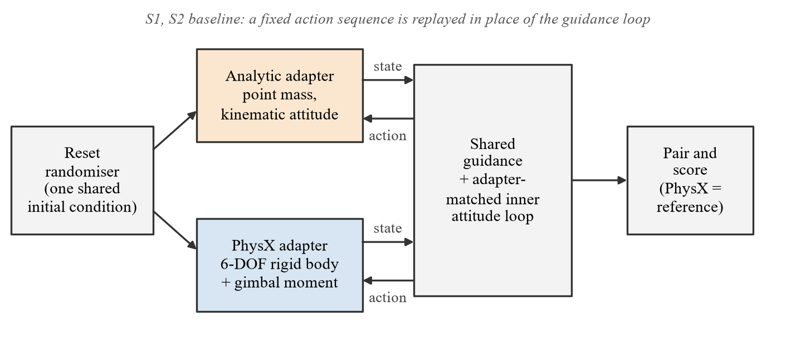
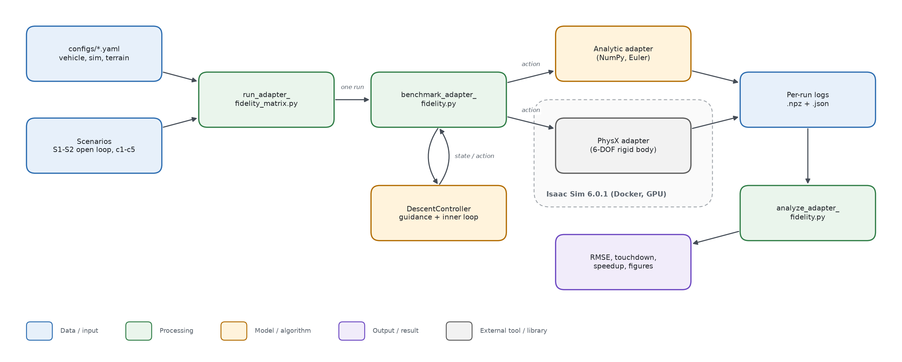
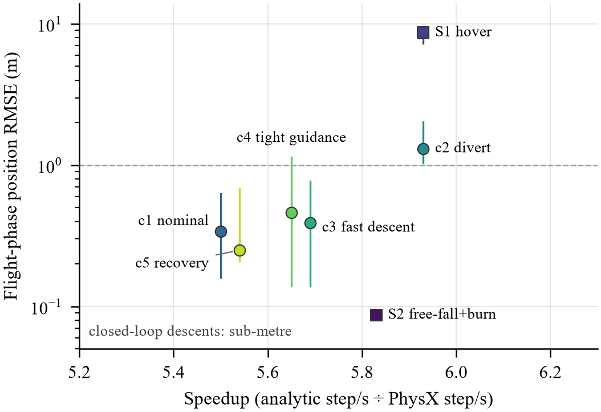
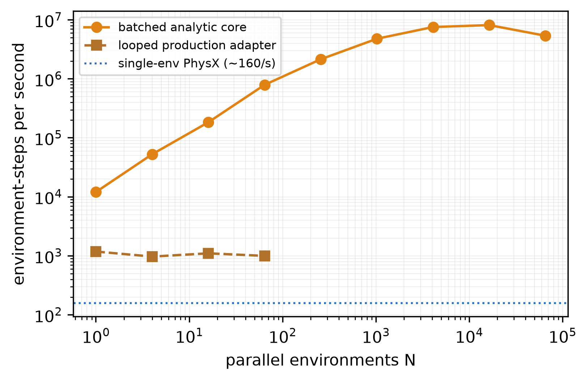

# SpeedVersusFidelity

**How much physical fidelity does a fast analytic lunar-landing simulator give up, compared with full PhysX rigid-body physics, in exchange for its speed?**

Two interchangeable simulators of the same lunar-landing rocket are compared: a fast analytic point-mass adapter (NumPy, kinematic thrust-aligned attitude) and a full PhysX adapter in Isaac Sim (6-DOF rigid body with gimbal moment).
A shared guidance law flies both from identical initial conditions; we measure step throughput and how far the two descent trajectories separate.
The goal is to know when the fast adapter can stand in for full physics in reinforcement-learning (RL) training and evaluation.



*Experiment flow. Each run resets both adapters to the same initial condition, flies them with the same guidance law, and scores the analytic trajectory against PhysX.*

## Overview

| | |
|---|---|
| **Problem** | Fast reduced-order simulators speed up RL training for propulsive landing but may misrepresent the dynamics; the size of that error is rarely measured. |
| **Method** | Closed-loop comparison (shared guidance + adapter-matched inner attitude loop) across 5 descent scenarios + 2 open-loop baselines, 5 repeats each; metrics: step/s, position/velocity/tilt RMSE, touchdown error. |
| **Simulation / hardware** | Isaac Sim 6.0.1 (headless, PhysX on CUDA) in Docker Desktop / WSL2 on an RTX 4050 Laptop (6 GB); analytic adapter in pure NumPy. Python 3.12. |
| **Paper** | In preparation (revision in progress: GPU-batched PhysX baseline, RL policy cross-evaluation, wider parameter sweeps). |

### System architecture



`run_adapter_fidelity_matrix.py` launches one subprocess per (scenario, repeat, adapter). `benchmark_adapter_fidelity.py` writes a shared initial condition, then steps one adapter with the `DescentController` in the loop (or replays a fixed action sequence for the open-loop baselines) and logs every step to `.npz` + `.json`. `analyze_adapter_fidelity.py` pairs analytic and PhysX runs and computes the fidelity metrics with PhysX as the reference.

## Selected results

### Result 1: about 5.7x faster, with sub-metre closed-loop error in four of five descents

Speedup against flight-phase position error for each scenario (median of 5 repeats, bars = min-max). Closed-loop descents stay within 0.25-1.31 m RMSE and 0.02-0.62 m touchdown error; the axial baseline S2 is near-exact (0.09 m). The one clear failure is S1: the analytic adapter discards a 5° reset tilt and drifts 8.7 m.



### Result 2: the analytic core scales with parallel environments

Environment-steps per second of a batched NumPy implementation of the analytic step versus the number of parallel environments N, against the single-environment PhysX rate (~160 step/s from the main matrix). Re-run on 2026-11-10 on the same laptop (CPU only); the peak is about 8.2 M step/s at N = 16 384. **Caveat:** PhysX here is single-environment, so this is not a like-for-like comparison; a GPU-batched PhysX baseline is being added.



*All figures are in `plots/`.*

## Installation

### Requirements

- Windows 11 or Linux, Python 3.12
- Analytic adapter, tests, analysis: CPU only
- PhysX adapter: NVIDIA GPU with CUDA, Docker, image `nvcr.io/nvidia/isaac-sim:6.0.1` (~32 GB)

### Steps

```bash
git clone https://github.com/BalBaZeuR0/SpeedVersusFidelity.git
cd SpeedVersusFidelity
python -m venv .venv && source .venv/bin/activate   # Windows: .venv\Scripts\activate
pip install -r requirements.txt
python -m unittest discover -s tests                # installation check
```

Expected output:

```
..............
----------------------------------------------------------------------
Ran 14 tests in 0.606s

OK
```

## Usage

### Analytic adapter only (no Isaac Sim needed)

```bash
python -m app.run_adapter_fidelity_matrix --adapters analytic --repeats 1 --scenarios c1_nominal c2_divert --out-dir outputs/demo
```

The first run downloads a lunar DEM into `assets/moon_heightmaps/` (git-ignored). Expected output (last lines):

```
[fidelity] c1_nominal__r00__analytic: 1275.8 step/s (rt x21.26), init_sync_err=0.00000 m (moved 0.00 m to align)
[fidelity] c2_divert__r00__analytic: 1255.5 step/s (rt x20.92), init_sync_err=0.00000 m (moved 0.00 m to align)

[matrix] done, 0 failed run(s)
```

### Full matrix with PhysX (Isaac Sim in Docker)

```bash
FID_REPEATS=5 FID_HORIZON=1000 FID_WARMUP=100 ./scripts/run_adapter_fidelity_docker.sh
python analysis/analyze_adapter_fidelity.py     # -> outputs/adapter_fidelity/analysis/metrics.csv, summary.csv
```

On Git Bash for Windows prefix the Docker command with `MSYS_NO_PATHCONV=1`. The full suite is 7 scenarios x 5 repeats x 2 adapters = 70 runs (~40 min on the laptop above).

## Reproducing the results

| Figure | Command |
|---|---|
| `plots/F4_tradeoff.png`, `plots/F1_flow.png`, `assets/hero.png` | `python scripts/make_paper_figures.py` (per-scenario medians recorded from the 2026-09-02 analysis run) |
| `plots/vectorized_throughput.png` | `python analysis/vectorized_throughput.py` (writes `outputs/adapter_fidelity/paper_figs/F9_vectorized_throughput.png`) |
| fidelity tables (`metrics.csv`, `summary.csv`) | full matrix with PhysX, then `python analysis/analyze_adapter_fidelity.py` |
| `assets/architecture.png` | `python scripts/flowchart.py assets/architecture.json` |

The raw per-step logs of the September 2026 matrix were not kept; the matrix is being re-run for the revised study.

## Project structure

```
SpeedVersusFidelity/
├── app/          # adapters, 6-DOF thrust model, controller, benchmark + matrix runner
├── analysis/     # pairing/metrics, extra tests (dt sweep, 6-DOF ablation), throughput, figures
├── assets/       # README images (hero.png, architecture.png + .json)
├── configs/      # vehicle, simulation, terrain and RL configuration (YAML)
├── docs/         # ADAPTER_FIDELITY.md: protocol and file roles in detail
├── plots/        # result figures (PNG + PDF)
├── scripts/      # Docker launchers, figure + diagram scripts
├── tests/        # unit tests (analytic path, no Isaac Sim)
├── NOTICE.md     # which files come from LunarRocket and what was changed
├── requirements.txt
└── README.md
```

## Citation, license, contact

```bibtex
@misc{ozkurt2026speedfidelity,
  title  = {Speed versus fidelity in lunar-landing reinforcement-learning simulators:
            a closed-loop comparison of an analytic point-mass surrogate and full rigid-body physics},
  author = {{\"O}zkurt, Cem and Onay, Muhammed Emin and Tun{\c{c}}, Ey{\"u}p Altu{\u{g}} and
            K{\"u}{\c{c}}{\"u}kler, Ahmet Kutay and {\"O}zt{\"u}rk, Emir},
  year   = {2026},
  howpublished = {\url{https://github.com/BalBaZeuR0/SpeedVersusFidelity}}
}
```

MIT License (see `LICENSE`). The simulator layer comes from [LunarRocket](https://github.com/GulogluHaktan/LunarRocket) (MIT); details in `NOTICE.md`. Contact: [@BalBaZeuR0](https://github.com/BalBaZeuR0), MTA Artificial Intelligence Center.
